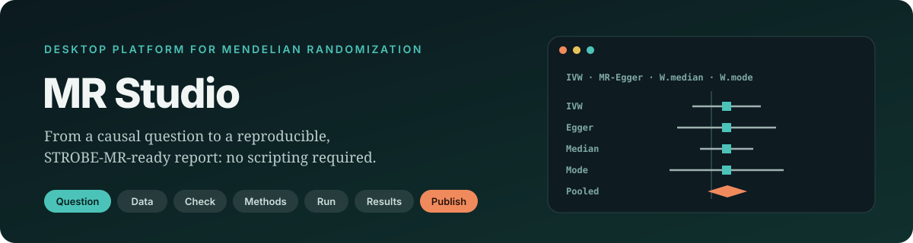
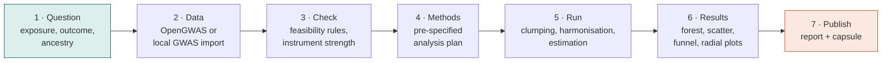
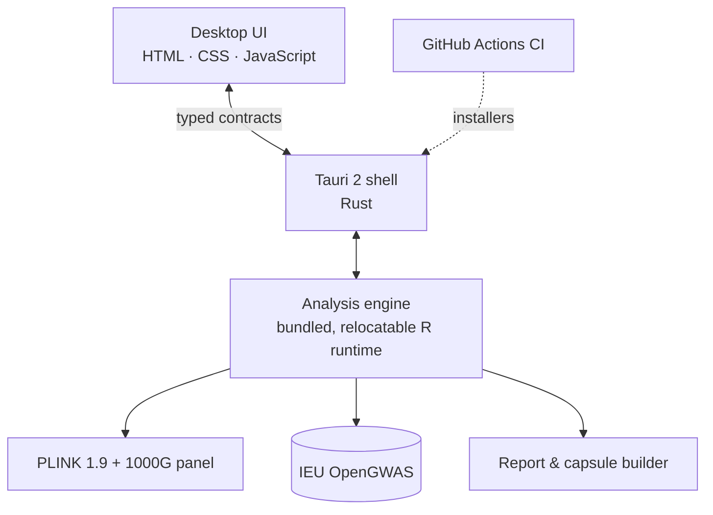

> **Status:** the source code is held in a private repository while the accompanying methods paper is being prepared. It will be released here, under an open-source licence, on publication. This page describes the design, features and validation.

## Why MR Studio?
Mendelian randomization (MR) uses genetic variants as natural experiments to estimate causal effects. Most errors in MR studies happen
**before** an estimator is run: in instrument selection, LD clumping, allele harmonisation, and the choice of sensitivity analyses. Script-based
workflows make these decisions hard to audit and put rigorous MR out of reach of many clinicians. MR Studio turns a full study into a guided,
transparent and reproducible desktop workflow.

## The study flow

## Features
| Area | What is included |
|---|---|
| **Data** | IEU OpenGWAS access with proxy search; an import wizard for local summary statistics (column mapping, build and strand checks) |
| **Instruments** | Local LD clumping with PLINK 1.9 on the 1000 Genomes reference panel, matching `ieugwasr::ld_clump_local`; F-statistics |
| **Harmonisation** | Palindromic and ambiguous SNP handling, compatible with TwoSampleMR |
| **Estimators** | IVW (fixed and random effects), MR-Egger, weighted median, simple median, weighted mode, MR-PRESSO, radial IVW/Egger |
| **Directionality** | MR Steiger, with liability-scale conversion for binary traits |
| **Feasibility engine** | 31 design rules drawn from published MR guidance, which flag problems before the analysis runs |
| **Reporting** | STROBE-MR checklist generator; Word/HTML report; PDF/SVG/PNG figures; Excel supplement; BibTeX/RIS references |
| **Reproducibility** | Every run exports a capsule with the inputs, versions, settings and log; checkpointed pause and resume |

## Validation
| Benchmark | Result |
|---|---|
| Bowden et al. (2016), *Genet Epidemiol*: reference estimates | Reproduced within 0.002 |
| Hemani et al. (2018), *eLife*: LDL cholesterol → coronary heart disease (TwoSampleMR reference example) | Identical to TwoSampleMR within ~1e-15 across all clumping modes |
| Real-data stress test: BMI → coronary heart disease | 501 instruments processed end-to-end |
| Automated test suite | ~297 engine, 54 script and 37 contract tests |

## Architecture

## Team
- **Ali Reza Soleymani Taloubaghi:** design and lead development
- **Dr. Danial Habibi** (Babol University of Medical Sciences): methods and validation
- Methods review: Dr. Mahdi Akbarzadeh (Research Institute for Endocrine Sciences, SBMU)

## Roadmap
- [x] M0: engine, feasibility rules, validation studies
- [ ] M1: public beta installers (macOS arm64/x64, Windows)
- [ ] Multivariable MR, MR-RAPS and colocalisation modules
- [ ] Methods paper and open-source release

Interested in testing the beta? Contact <a href="mailto:alirezasoleymani24@gmail.com">alirezasoleymani24@gmail.com</a>
